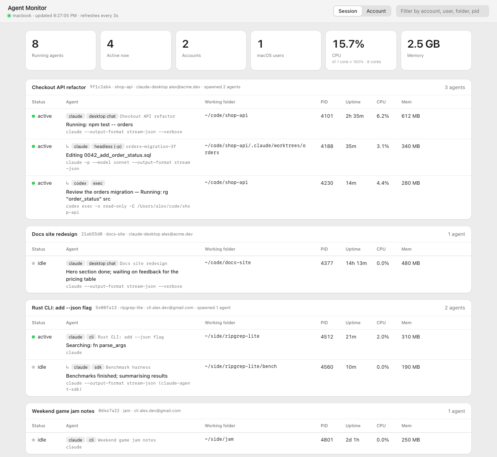
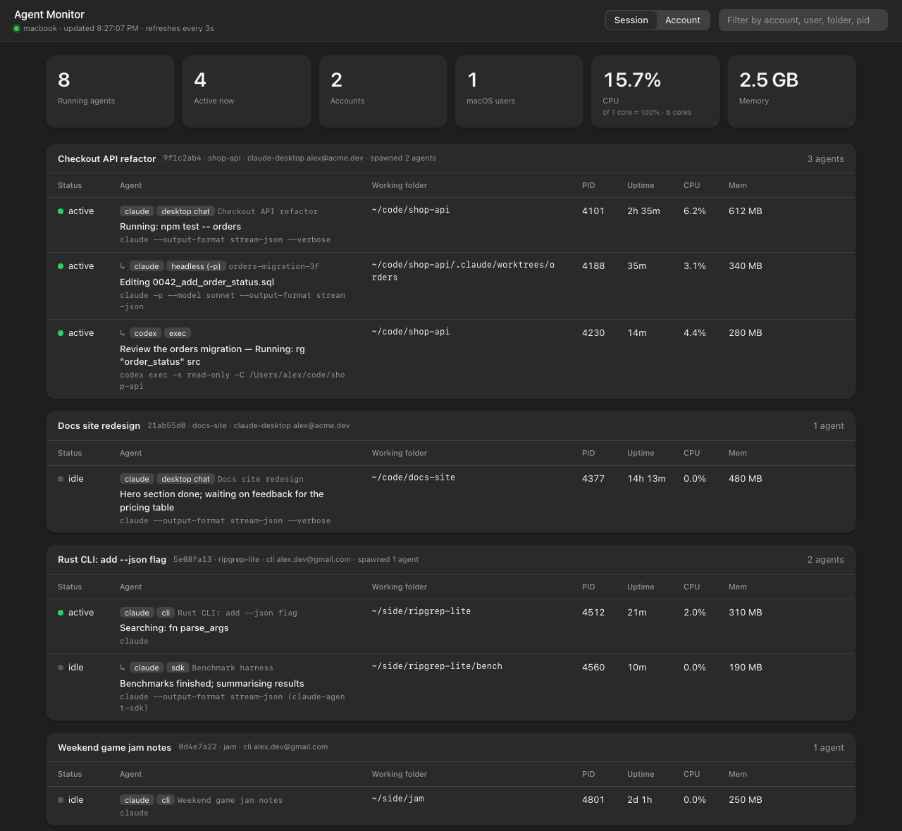

# Agent Monitor

A local dashboard for every AI coding agent running on your Mac: Claude Code, Claude Desktop chats, Agent SDK runs, Codex, and more. Agents are grouped by the chat session that started them and show what each one is doing right now.

<p align="center">
  
  
</p>

> Screenshots use synthetic data (`python3 server.py --demo`).

## Features

- **Grouped by owning session.** Sub-agents, `claude -p` runs and Codex jobs sit under the chat that spawned them, even when a script detached them from their parent process. Switch to **Account** to group by login instead.
- **Chat names.** Sessions show the name you gave them in Claude Desktop, or the auto-generated title.
- **A one-line "what is it doing".** For Claude, the tool call in progress (`Running: npm test`, `Editing schema.sql`) or the last status line. For Codex jobs, the task and the command it is running.
- **Several accounts at once.** Each Claude process reports the login it runs under, and Codex reports its own.
- **Accurate labels.** `desktop chat`, `cli`, `headless (-p)`, `sdk`, plus Codex `exec` and `app-server`.
- **Live status.** Active or idle, with CPU, memory and uptime per agent, plus total agent CPU and memory at the top, refreshed every 3 seconds.
- **Stop button.** Click **Stop**, then **Confirm?**, to send SIGTERM to an agent. If it is still running afterwards the button becomes **Force quit** (SIGKILL). Only your own processes get a button.
- **Search** across chat names, summaries, folders, accounts and PIDs. Light and dark themes follow macOS (`?theme=light|dark` forces one).

## Run it

Requires Python 3.9+ and macOS. There are no dependencies.

```sh
python3 server.py            # http://127.0.0.1:8787
python3 server.py --port 9000
python3 server.py --demo     # fake data, safe for screenshots
```

## How it works

Everything is read from local files and the process table, and nothing leaves your machine. The only write action is the Stop button.

| What | Where it comes from |
|---|---|
| Agents | `ps` process table (`claude`, `codex`, `gemini`, `aider`) |
| Owning session | Parent process chain, falling back to the `CLAUDE_PID` / `CLAUDE_CODE_SESSION_ID` a child inherits |
| Chat name, mode | `~/.claude/sessions/<pid>.json`, Claude Desktop's session store, transcript titles |
| Claude activity | Tail of the session transcript in `~/.claude/projects/` |
| Claude account | `CLAUDE_CODE_USER_EMAIL` in the process environment, else `~/.claude.json` |
| Codex activity | The job's brief (stdin) and live log (stdout), found with `lsof` |
| Codex account | `~/.codex/auth.json` |

## Limitations

- Processes owned by other macOS users are listed, but their environment, working folder and files can only be read if the server runs with enough privileges (for example `sudo python3 server.py`).
- Codex app servers have no per-job progress. They show a fixed label.
- Session ownership relies on inherited environment variables. A process started with a clean environment shows up on its own.
- The server binds to `127.0.0.1` only. Don't expose it: the page lists working folders and what your agents are doing, and it can stop processes.
- Stop requests need a per-run secret token that only the served page has, a localhost `Host`/`Origin`, and a PID that is currently a detected agent you own, so other sites and stale PIDs can't trigger it. Stopping a session does not stop the agents it spawned.
- Stop is disabled in `--demo` mode.
